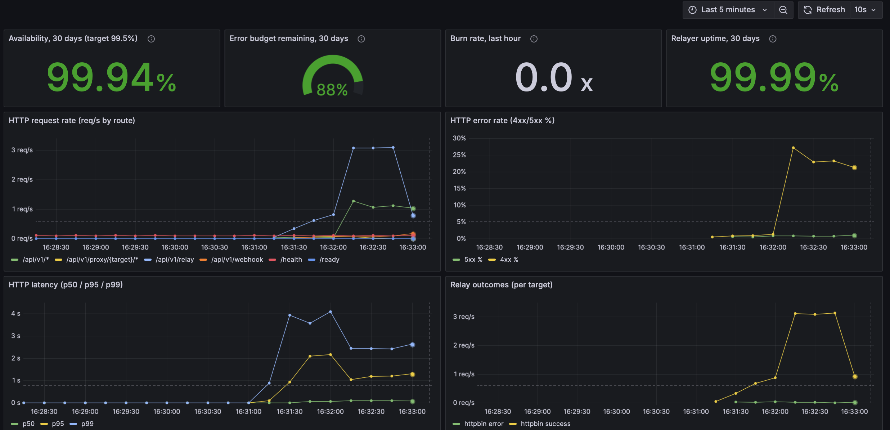
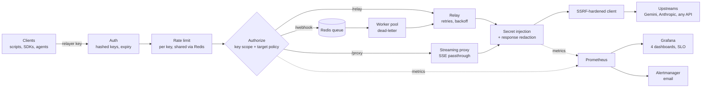

<!--
GitHub repo description (apply manually under Settings > About):
Self-hosted credential broker in Go: scoped, revocable keys for APIs and LLMs; real secrets stay on the
relayer. Streaming proxy, Redis queue, shared rate limits, Prometheus/Grafana, Pi over Tailscale.
-->

# Credential Relayer

[](https://github.com/ricardo1slas/credential-relayer/actions/workflows/ci.yml)
[](https://github.com/ricardo1slas/credential-relayer/actions/workflows/security.yml)
[](LICENSE)

**TL;DR**
- A Go service that holds your real API keys (Gemini, Anthropic, any HTTP API) and hands clients scoped, revocable *relayer keys* instead.
- It injects the secret, enforces per-key scope and per-target policy, rate-limits, and streams responses, so SDKs and agents work unchanged.
- It runs on a Raspberry Pi that is reachable only over the tailnet (deny-by-default Tailscale ACLs), with Prometheus, Grafana, SLO alerting and fuzz-tested request policy.

**Results**

| | |
|---|---|
| **3.7x throughput from one profile** | `pprof` showed ~80% of CPU in TCP dials: a timeout context cancelled before the body was read made `net/http` drop every connection. Fixed: 282 -> 1048 req/s at 200 concurrent, p95 1.95 s -> 0.41 s ([details](#performance)). |
| **Fuzzing found a header bypass** | `FuzzHeaderFilter` found that `X_Real_IP` / `Transfer_Encoding`-style names slipped past the header deny-list, and backends that fold `_` to `-` would read them as the denied header. Names are now folded before the check; the path policy was fuzzed over 4.4M inputs. |



## What it is

**A self-hosted credential broker for APIs and LLMs, written in Go.** Clients get scoped, revocable
*relayer keys* and call upstream services by name; the real API keys live only on the relayer, which
injects them, enforces what each key may do, and records who used what. It works for plain JSON calls,
durable webhooks, and as a drop-in streaming proxy for SDKs and agents such as Gemini CLI and the
Anthropic SDK.

**Why:** API keys sprawl into phones, scripts, CI and laptops. Every copy is a leak waiting to happen, and
a leaked key can do anything the account can. With the relayer, a stolen laptop exposes a relayer key
that is scoped to one target, one method and one path, rate-limited, logged, and revoked in one line.

> "Private" means privately hosted (it runs on a Raspberry Pi reachable only over Tailscale), not
> anonymity: this is not an Apple iCloud Private Relay-style privacy service. Inspired by
> [OpenZeppelin Relayer](https://github.com/openzeppelin/openzeppelin-relayer), which holds signing keys
> so clients only submit intents, generalized from blockchain keys to any API secret.



## What it does

- **Credential injection**: a target's secrets (API keys, bearer tokens) are read at startup through a
  `SecretProvider` (environment variables today) and added to every outbound request. Clients never see,
  override or exfiltrate them.
- **Per-key scopes and per-target policy**: each relayer key may use only the targets it lists; each target
  may restrict methods, path prefixes and body size (`POST /v1/messages` only, say).
- **Three ways in**, all behind the same gate:
  - `POST /api/v1/relay`: synchronous JSON envelope, retries on 5xx and transport errors (never 4xx) with
    exponential backoff and jitter.
  - `POST /api/v1/webhook`: returns `202` with a job ID; a worker pool delivers it at least once, with
    retries and a dead-letter state. A job held by a worker that crashes or is stopped goes back on the
    queue; `GET /api/v1/jobs/{id}` reports status (a key only sees its own jobs).
  - `/api/v1/proxy/{target}/...`: a transparent passthrough that streams responses (SSE) as they arrive, so
    SDKs work unchanged by pointing their base URL at the relayer.
- **Auth**: keys stored as SHA-256 hashes, optional expiry, overlapping keys for rotation.
- **Rate limiting per key**: a token bucket in Redis (atomic Lua script) shared by every instance, or in
  memory for a single instance; see [Limitations](#limitations--non-goals).
- **Observability**: structured logs that name the key behind every call, Prometheus metrics, four
  provisioned Grafana dashboards, a 30-day availability SLO and burn-rate alerting by email.
- **Go SDK** in [`pkg/client`](pkg/client), health/readiness probes, graceful shutdown.

## Demo: Gemini CLI through a Raspberry Pi

Gemini CLI running on a laptop, with the real Gemini API key only on the Pi:

```bash
ssh -f -N -L 8081:<pi-tailnet-ip>:8080 <user>@<pi-host>      # Gemini CLI wants HTTPS or localhost
export GOOGLE_GEMINI_BASE_URL=http://localhost:8081/api/v1/proxy/gemini
export GEMINI_API_KEY=<relayer key scoped to targets: ["gemini"]>
npx @google/gemini-cli
```

The CLI sends the relayer key as `x-goog-api-key`; the relayer authenticates it, checks the key's scope and
the target's policy, swaps in the real key, streams the answer back, and never forwards the relayer key.
When the agent's growing context exceeded the target's body limit, the relayer refused it with a clear
`413` and the Security dashboard counted it under the calling key.

## Design decisions

Each has a short ADR in [`docs/adr/`](docs/adr/README.md).

- **Targets by name, never by URL.** A client can't point the relayer anywhere; the SSRF surface is the path
  alone, and that is resolved, validated and fuzzed.
- **One gate.** `/relay`, `/webhook` (at enqueue), `/proxy` and the worker all call `Authorize`. Adding an
  entry point can't forget a check, and every refusal is counted in one place.
- **Secrets by env-var name, fail fast.** Config holds `X-Api-Key: GEMINI_API_KEY`, never the key. A missing
  variable stops startup instead of sending unauthenticated requests.
- **No retries on the proxy.** A stream can't be replayed and LLM POSTs aren't idempotent; `/relay` retries
  only 5xx and transport errors.
- **Redact streams with a minimal hold-back.** Only a tail that could still grow into a secret is held, so
  SSE events flush immediately; a truncated stream drops the held tail rather than leak half a secret.
- **Metric labels come from config, not clients.** An unknown target is recorded as `unknown`, so a client
  inventing names can't blow up Prometheus.
- **The SLO excludes 502.** A 502 means the upstream failed; the relayer's availability counts only failures
  it caused. Upstream health has its own dashboard.
- **No public ingress.** The Pi is tailnet-only, behind deny-by-default Tailscale ACLs; CI joins the tailnet
  as an ephemeral tagged node and deploys only commits that passed CI.

## Security

Threats were modeled first ([`docs/security-roadmap.md`](docs/security-roadmap.md), STRIDE plus privacy) and
the findings fixed and regression-tested (the key tests were verified by deliberately breaking the fix and
watching them fail). Report vulnerabilities privately: see [`SECURITY.md`](SECURITY.md).

<details>
<summary>Controls by area</summary>

| Area | Control |
|---|---|
| Upstream secrets | Loaded at startup (refuses to start if missing), never from YAML or client input; injected last so clients can't override them (including `_`-folded spellings); stripped on cross-host or scheme-changing redirects (Go's client only strips `Authorization`/`Cookie`); redacted if the upstream echoes them, even split across stream chunks; never written to Redis |
| AuthN / AuthZ | Hashed keys, constant-time compare, expired and unknown keys indistinguishable; one `Authorize` gate for every entry point: key scope first (a key can't tell a forbidden target from a missing one), then method, path and body policy; 404 (not 403) on other keys' jobs |
| Request policy | Paths judged after `../` resolution on segment boundaries; encoded `%2e`/`%2f`/`%5c`, `\` and `;` refused so an upstream can't normalize its way out of the prefix (fuzzed, 4.4M inputs) |
| SSRF | Target chosen by name, never by URL; client path resolved against the base URL and checked (fuzzed); dial-time resolution blocks private/loopback addresses; redirects capped and re-validated; HTTPS-only targets by default |
| Streaming proxy | The caller's relayer key (`x-api-key` / `x-goog-api-key`) is never forwarded; `Accept-Encoding` stripped so redaction sees plaintext; upstream `Set-Cookie` dropped; the server write deadline is lifted only for the proxied response |
| Request smuggling | Header allow/deny-list that also folds `_` to `-` (a bypass found by fuzzing); hop-by-hop and auth headers never forwarded |
| Resource limits | Global and per-target body caps, response caps, server timeouts, per-key rate limits shared across instances, bounded rate-limiter memory, bounded metric label values |
| Supply chain | `govulncheck`, `gosec`, `gitleaks` over the full history, Trivy (image and IaC), Dependabot; non-root, read-only, capability-dropped containers |
| Deployment | Tailnet-only, deny-by-default Tailscale ACLs, tag-based access, ephemeral CI nodes, deploys gated on passing CI, host firewall, deploy refused with the default Grafana password ([`docs/hardening.md`](docs/hardening.md)) |

</details>

## Limitations & non-goals

- **Secrets come from environment variables.** They are read once at startup, so rotating one means a
  restart. A `SecretProvider` interface (`internal/relay/target.go`) is the seam for Vault or a cloud secrets
  manager; only the env implementation exists.
- **Keys are managed in YAML plus a redeploy.** There is no admin API and no hot reload: adding, revoking or
  rotating a relayer key is a config edit and `make deploy-pi`.
- **Webhook delivery is at-least-once, not exactly-once.** A worker that dies after the upstream accepted a
  job but before marking it done leaves it to be requeued (after the slowest target's full timeout plus
  `retry_delay` and a minute), so the upstream can see it twice. Targets should treat webhooks as
  idempotent; jobs carry no idempotency key yet.
  A worker stalled past that recovery limit (GC pause, network partition, an overloaded host) can still
  overwrite the status of its job's redelivered attempt; fixed in the next release.
- **Logs are not a durable audit trail.** Structured logs name the key behind each call, but they go to
  stdout/Docker with no tamper evidence or guaranteed retention.
- **Single region.** The Pi is one host with one Redis; the AWS reference is one region (prod ElastiCache has
  a multi-AZ replica). Redis is required (queue and, by default, rate limits).
- **Rate-limit behavior depends on the backend** (`rate_limit.backend`):
  - `redis` (default): one budget per key shared by every instance; one Redis round trip per API request. If
    Redis errors, requests are refused with `503` (fail-closed) unless `rate_limit.fail_open: true`; either
    way it is counted in `relayer_ratelimit_backend_errors_total{decision}`.
  - `memory`: per process, so N instances allow N times the limit. Fine for the single Pi, wrong behind a
    load balancer.

## Performance

Measured on a **Raspberry Pi 4** (4 cores) against a local upstream, load generated over Tailscale
(`make bench`; method and raw results in [`benchmarks/`](benchmarks/README.md)):

| Scenario | req/s | p50 | p95 |
|---|---|---|---|
| Relay, 50 concurrent | 976 | 46 ms | 98 ms |
| Relay, 200 concurrent | 1048 | 168 ms | 409 ms |

A CPU profile (`pprof`) showed ~80% of time spent dialing new TCP connections: the per-request timeout
context was cancelled before the response body was read, so `net/http` discarded every connection.
Cancelling on `Body.Close()` instead took 200-concurrency throughput from **282 to 1048 req/s (3.7x)**
and p95 from 1.95 s to 0.41 s. A regression test pins the behaviour.

## Dashboards and alerting

Four Grafana dashboards are provisioned with the stack (colors from a colorblind-validated palette):

| Dashboard | Shows |
|---|---|
| **Credential Relayer** | Traffic, errors, latency, queue, and the SLO row: 30-day availability (target 99.5%), error budget remaining, burn rate, uptime |
| **Security & usage** | Everything the gate refused, by reason (scope, method, path, body, unknown target), a per-key usage table, one panel per key |
| **LLM & upstreams** | Time to first byte as a heatmap (the whole latency distribution over time), p50/p95, upstream outcomes by status class, quota exhaustion (upstream 429s) |
| **Pi host** | CPU temperature (a Pi 4 throttles at 80 °C), clock speed vs max, CPU, load, memory, SD card |

Alerts (Alertmanager, email): relayer down, 5xx rate, latency, failing upstreams, queue backlog, dead-lettered
jobs, auth-failure and rate-limit spikes, a multi-window **SLO burn-rate** alert (14.4x), upstream quota
exhausted, Pi overheating, SD card filling, host metrics missing.

`make traffic` sends a steady mix of requests (successes, retries, auth failures, scope and policy refusals,
async jobs, streamed responses) so every panel has something to show.

## Quick start

Requires Go 1.26+ and Docker.

```bash
cp configs/config.example.yaml configs/config.yaml   # add a key: make new-key
make docker-up          # relayer + redis + prometheus + alertmanager + grafana + node-exporter
```

| Service | URL |
|---|---|
| Relayer API | http://localhost:8080 |
| Prometheus / Alertmanager | http://localhost:9091 / http://localhost:9093 |
| Grafana | http://localhost:3000 (`admin` / `admin`, **dev only**: `make deploy-pi` refuses to start without `GRAFANA_PASSWORD`) |

```bash
# relay synchronously
curl -X POST localhost:8080/api/v1/relay \
  -H "X-API-Key: <your-api-key>" -H "Content-Type: application/json" \
  -d '{"target":"httpbin","method":"GET","path":"/get"}'

# stream through the proxy (GET/POST/PUT/PATCH/DELETE, raw body, response streamed back)
curl -N "localhost:8080/api/v1/proxy/httpbin/drip?duration=2" -H "X-API-Key: <your-api-key>"

# queue a webhook, then poll the job
curl -X POST localhost:8080/api/v1/webhook -H "X-API-Key: <your-api-key>" \
  -H "Content-Type: application/json" \
  -d '{"target":"httpbin","method":"POST","path":"/post","body":{"hello":"world"}}'
curl localhost:8080/api/v1/jobs/<job_id> -H "X-API-Key: <your-api-key>"
```

### Configuration

`configs/config.yaml` plus `RELAYER_*` environment overrides. Use `__` between levels:
`RELAYER_RATE_LIMIT__FAIL_OPEN=true` -> `rate_limit.fail_open`. Names without `__` keep the older form, where every
`_` is a level (`RELAYER_SERVER_PORT` -> `server.port`), which only reaches keys without underscores. Lists
(`auth.api_keys`, `relay.targets`) can't be overridden element by element; set them in YAML.
The annotated [`configs/config.example.yaml`](configs/config.example.yaml) lists every option.

```yaml
auth:
  api_keys:
    - name: "phone"
      key_sha256: "<make new-key prints this>"   # or `key:` (dev only, 32+ chars)
      expires_at: "2027-03-01"                   # optional
      targets: ["gemini"]                        # least privilege; [] or ["*"] = all
rate_limit: { requests: 100, window: 60s, backend: redis, fail_open: false }
relay:
  max_request_bytes: 8388608                     # global ceiling; targets can cap lower
  targets:
    - name: "gemini"
      url: "https://generativelanguage.googleapis.com"
      secret_headers:
        X-Goog-Api-Key: GEMINI_API_KEY           # env var NAME; the value never lives in YAML
      allow_methods: ["GET", "POST"]
      allow_paths: ["/v1beta/models"]
      max_body_bytes: 4194304                    # agents resend the whole conversation each turn
      timeout: 120s                              # bounds a whole streamed response
queue:
  redis: { addr: "localhost:6379" }
  workers: 5
metrics: { enabled: true, port: 9090 }           # /metrics is served here, not on the API port
```

The secret itself goes in the host's environment for the relayer container only:

```bash
# on the host: gitignored, preserved by `make deploy-pi`, never given to the other containers
nano infra/docker/.env.relayer     # add GEMINI_API_KEY=<real key>; chmod 600
```

Rotating an upstream key is one edit there plus `make deploy-pi`. Rotating a relayer key is `make new-key`
and swapping the hash; overlapping entries with the same name allow a zero-downtime switch.

### SDKs and agents (`/api/v1/proxy`)

Anything that lets you set a base URL works. The Anthropic SDK and Claude Code send `ANTHROPIC_API_KEY` as
`x-api-key`, Google SDKs send `GEMINI_API_KEY` as `x-goog-api-key`; the relayer accepts its own key in
either header, so the client is configured with a relayer key and nothing else changes:

```bash
export ANTHROPIC_BASE_URL=http://<relayer-host>:8080/api/v1/proxy/anthropic
export ANTHROPIC_API_KEY=<relayer key scoped to targets: ["anthropic"]>
```

The proxy applies the same key scope, target policy and secret injection as `/relay` and has no retries.
The target's `timeout` bounds the whole stream, so give LLM targets a long one.

### Go SDK

```go
c := client.New("http://localhost:8080", apiKey)
resp, err := c.Relay(ctx, client.RelayRequest{Target: "httpbin", Method: "GET", Path: "/get"})
jobID, err := c.Webhook(ctx, client.WebhookRequest{Target: "httpbin", Method: "POST", Path: "/post"})
```

## Deployment

**Live: Raspberry Pi over Tailscale.** `make deploy-pi` rsyncs the repo and runs Docker Compose on the Pi;
every port binds to the Pi's tailnet address only, and the deploy refuses to start while Grafana would use
the default password. Machine-specific values (`PI`, relayer URL, key file) go in a gitignored `local.mk`
([`local.mk.example`](local.mk.example)). On a push to `main`, once `ci` passes, a GitHub Actions runner joins
the tailnet as an ephemeral, tagged node and deploys exactly the tested commit; it runs only in a repository
that sets the `PI_HOST` and `PI_USER` variables. Setup, ACL policy and email alerts:
[`docs/pi-deploy.md`](docs/pi-deploy.md).

**Reference: AWS via Terraform.** [`infra/terraform`](infra/terraform) defines a VPC, ALB, ECS Fargate service
(2 tasks in prod, which is why rate limits live in Redis), ElastiCache Redis, ECR, CloudWatch dashboard and
alarms, and a GitHub OIDC role (no long-lived AWS keys). The AWS deploy workflow is manual-only.

Operations: [`docs/runbook.md`](docs/runbook.md). Hardening and the security backlog: [`docs/hardening.md`](docs/hardening.md).

## Project layout

```
cmd/relayer/          entrypoint
internal/api/         router, middleware, webhook, job and proxy routes
internal/auth/        API-key auth, scopes
internal/relay/       Authorize gate, relay, streaming proxy, secret injection and redaction,
                      target policy, SSRF-hardened client, retries (+ fuzz tests)
internal/queue/       Redis queue, worker pool, job model
internal/ratelimit/   token bucket: Redis (Lua, shared) or in-memory
internal/metrics/     Prometheus metrics
internal/config/      YAML + env config
pkg/client/           Go SDK
test/e2e/             black-box tests through the real router
benchmarks/           isolated benchmark stack and results
docs/                 runbook, hardening, threat model, ADRs, build log
infra/docker/         Dockerfile, Compose, Prometheus + alerts, Alertmanager, Grafana dashboards
infra/terraform/      AWS modules and environments
.github/workflows/    ci (lint, race tests + coverage summary, image), security, deploy (Pi, gated on ci), deploy-aws (manual)
```

## Development

```bash
make test        # unit + e2e (Redis-backed cases skip if Redis is down)
make lint        # golangci-lint
make cover       # total test coverage
make traffic     # synthetic traffic for the dashboards
make bench       # benchmark suite on the Pi, incl. relayer overhead vs. direct
go test ./internal/relay -fuzz=FuzzPathPolicy -fuzztime=30s
```

[`docs/build-log.md`](docs/build-log.md) is the dated build log: decisions, bugs found and why.
[`RELEASE_NOTES.md`](RELEASE_NOTES.md) has the per-release changes.

## License

[MIT](LICENSE)
