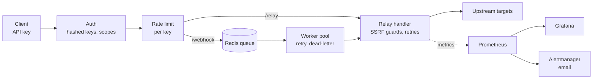

# Private Relayer

[](https://github.com/ricardo1slas/private_relayer/actions/workflows/ci.yml)
[](https://github.com/ricardo1slas/private_relayer/actions/workflows/security.yml)
[](LICENSE)

A self-hosted **HTTP request relayer** written in Go. Clients authenticate with an API key and ask the
relayer to call a *named* upstream target on their behalf, synchronously (`/relay`) or through a durable
Redis queue (`/webhook`). The relayer holds the upstream details, enforces who may use which target, and
adds retries, rate limiting and observability. Inspired by
[OpenZeppelin Relayer](https://github.com/openzeppelin/openzeppelin-relayer), generalized beyond blockchains.

It doubles as a DevSecOps portfolio project: the interesting parts are the security posture, the
zero-trust deployment on a Raspberry Pi over Tailscale, and the measured performance work below.



## What it does

- **Relay** (`POST /api/v1/relay`): forwards a request to a configured target with per-target timeout,
  retries on 5xx and transport errors only (never on 4xx), exponential backoff with jitter.
- **Async webhooks** (`POST /api/v1/webhook`): returns `202` with a job ID; a worker pool delivers it with
  retries and a dead-letter state; `GET /api/v1/jobs/{id}` reports status.
- **Streaming proxy** (`/api/v1/proxy/{target}/...`): a transparent passthrough with streamed (SSE) responses,
  so SDKs work unchanged by pointing their base URL at the relayer (e.g. `ANTHROPIC_BASE_URL`).
- **Credential injection**: a target's upstream secrets (API keys, bearer tokens) live only on the relayer
  and are added to every outbound request. Clients name the target and never see, override or
  exfiltrate the secret.
- **Per-target policy**: allowed methods, path prefixes and a body-size cap for each target, enforced on
  `/relay`, on `/webhook` before a job is queued, and again in the worker.
- **Auth**: API keys stored as SHA-256 hashes, optional expiry, overlapping keys for rotation,
  per-key **target allow-lists**, and job ownership (a key can only read its own jobs).
- **Rate limiting**: token bucket per API key.
- **Observability**: structured JSON logs (zerolog), Prometheus metrics on a separate port, a provisioned
  Grafana dashboard, and Prometheus alert rules delivered by Alertmanager email.
- **Go SDK** in [`pkg/client`](pkg/client), health/readiness probes, graceful shutdown.

## Security

Threats were modeled first ([`docs/security-roadmap.md`](docs/security-roadmap.md), STRIDE plus privacy) and
the findings fixed and regression-tested. Highlights:

| Area | Control |
|---|---|
| SSRF | Target chosen by name, never by URL; client path resolved against the base URL and checked (fuzzed); dial-time resolution blocks private/loopback addresses; redirects capped and re-validated; HTTPS-only targets by default |
| Upstream secrets | Loaded from env at startup, never from YAML or client input; injected last so clients can't override them (including `_`-folded spellings); dropped on cross-host or scheme-changing redirects; redacted if the upstream echoes them; never written to Redis |
| Streaming proxy | Same gate as `/relay`; the caller's `x-api-key` is never forwarded; `Accept-Encoding` stripped so redaction sees plaintext; secrets redacted across chunk boundaries (held back only while a tail could still become a secret; dropped if the stream is truncated); upstream `Set-Cookie` not passed back; the server write deadline is lifted only for the proxied response |
| Request policy | Per-target method, path-prefix and body-size rules; paths judged after `../` resolution; encoded `%2e`/`%2f`/`%5c`, `\` and `;` refused so an upstream can't normalize its way out of the prefix (fuzzed) |
| Request smuggling | Header allow/deny-list that also folds `_` to `-` (a bypass found by fuzzing); hop-by-hop and auth headers never forwarded |
| AuthN / AuthZ | Hashed keys, constant-time compare, expired and unknown keys indistinguishable; per-key target scopes fail closed; 404 (not 403) on other keys' jobs |
| Resource limits | Inbound and response body caps, server timeouts, bounded rate-limiter memory |
| Data at rest | Sensitive headers stripped before jobs are persisted; short TTLs |
| Supply chain | `govulncheck`, `gosec`, `gitleaks` (full history), Trivy (image and IaC), Dependabot; non-root, read-only, capability-dropped containers |
| Deployment | Tailscale deny-by-default policy with tests, tag-based access, ephemeral CI nodes, host firewall ([`docs/hardening.md`](docs/hardening.md)) |

Report vulnerabilities privately: see [`SECURITY.md`](SECURITY.md).

## Performance

Measured on a **Raspberry Pi 4** (4 cores) against a local upstream, load generated over Tailscale
(`make bench`; method and raw results in [`benchmarks/`](benchmarks/README.md)):

| Scenario | req/s | p50 | p95 |
|---|---|---|---|
| Relay, 50 concurrent | 976 | 46 ms | 98 ms |
| Relay, 200 concurrent | 1048 | 168 ms | 409 ms |

A CPU profile (`pprof`) showed ~80% of time spent dialing new TCP connections: the per-request timeout
context was cancelled before the response body was read, so `net/http` discarded every connection.
Cancelling on `Body.Close()` instead took 200-concurrency throughput from **282 to 1048 req/s (3.7x)**
and p95 from 1.95 s to 0.41 s. A regression test pins the behaviour.

## Quick start

Requires Go 1.26+ and Docker.

```bash
cp configs/config.example.yaml configs/config.yaml   # set a real key: make new-key
make docker-up          # relayer + redis + prometheus + alertmanager + grafana
```

| Service | URL |
|---|---|
| Relayer API | http://localhost:8080 |
| Prometheus / Alertmanager | http://localhost:9091 / http://localhost:9093 |
| Grafana | http://localhost:3000 (`admin` / `admin`, dashboard "Private Relayer") |

```bash
# relay synchronously
curl -X POST localhost:8080/api/v1/relay \
  -H "X-API-Key: <your-api-key>" -H "Content-Type: application/json" \
  -d '{"target":"httpbin","method":"GET","path":"/get"}'

# queue a webhook, then poll the job
curl -X POST localhost:8080/api/v1/webhook -H "X-API-Key: <your-api-key>" \
  -H "Content-Type: application/json" \
  -d '{"target":"httpbin","method":"POST","path":"/post","body":{"hello":"world"}}'
curl localhost:8080/api/v1/jobs/<job_id> -H "X-API-Key: <your-api-key>"
```

`make traffic` sends a steady mix of requests (successes, 4xx/5xx, auth failures, bursts) so the
dashboard has something to show.

### Configuration

`configs/config.yaml` plus `RELAYER_*` environment overrides (`RELAYER_SERVER_PORT` -> `server.port`).

```yaml
auth:
  api_keys:
    - name: "phone"
      key_sha256: "<make new-key prints this>"   # or `key:` for dev only
      expires_at: "2027-03-01"                   # optional
      targets: ["httpbin"]                       # least privilege; [] or ["*"] = all
rate_limit: { requests: 100, window: 60s }
relay:
  targets:
    - { name: "httpbin", url: "https://httpbin.org", timeout: 5s, retries: 3 }
queue:
  redis: { addr: "localhost:6379" }
  workers: 5
metrics: { enabled: true, port: 9090 }     # /metrics is served here, not on the API port
```

#### Upstream credentials

Map a header to the **name** of an environment variable. The relayer reads the value at startup
(and refuses to start if it is unset) and adds it to every request to that target:

```yaml
relay:
  targets:
    - name: "anthropic"
      url: "https://api.anthropic.com"
      secret_headers:
        X-Api-Key: ANTHROPIC_API_KEY
      # Scope what the credential can be used for: without this, any key allowed to use the
      # target can call any endpoint of the upstream with your secret.
      allow_methods: ["POST"]
      allow_paths: ["/v1/messages"]
      max_body_bytes: 262144
```

```bash
# on the host (gitignored, preserved by `make deploy-pi`, given only to the relayer container)
echo 'ANTHROPIC_API_KEY=<real key>' >> infra/docker/.env.relayer && chmod 600 infra/docker/.env.relayer
```

Clients call `{"target":"anthropic", ...}` with their own relayer key. Rotating the upstream key is one
edit on the host plus `make deploy-pi`, which recreates the container with the new environment.

#### SDKs and streaming (`/api/v1/proxy`)

SDKs that only let you change the base URL go through the streaming proxy. The Anthropic SDK and
Claude Code send `ANTHROPIC_API_KEY` as `x-api-key`, which is exactly the relayer's auth header, so the
client gets a **relayer key** and never sees the real one:

```bash
export ANTHROPIC_BASE_URL=http://<relayer-host>:8080/api/v1/proxy/anthropic
export ANTHROPIC_API_KEY=<relayer key from make new-key>   # scoped to targets: ["anthropic"]
```

The proxy applies the same key scope, target policy and secret injection as `/relay`, streams the
response as it arrives, and never forwards the caller's relayer key upstream. Secrets echoed in the
stream are redacted even when split across chunks. There are no retries (a stream can't be replayed),
and the target's `timeout` bounds the whole stream, so give LLM targets a long one (e.g. `timeout: 600s`).

### Go SDK

```go
c := client.New("http://localhost:8080", apiKey)
resp, err := c.Relay(ctx, client.RelayRequest{Target: "httpbin", Method: "GET", Path: "/get"})
jobID, err := c.Webhook(ctx, client.WebhookRequest{Target: "httpbin", Method: "POST", Path: "/post"})
```

## Deployment

**Live: Raspberry Pi over Tailscale.** `make deploy-pi` (or a push to `main` once `ci` passes, via a GitHub Actions runner that
joins the tailnet as an ephemeral, tagged node) rsyncs the repo and runs Docker Compose on the Pi. Every port
binds to the Pi's tailnet address only. Setup, ACL policy and email alerts: [`docs/pi-deploy.md`](docs/pi-deploy.md).

**Reference: AWS via Terraform.** [`infra/terraform`](infra/terraform) defines a VPC, ALB, ECS Fargate service,
ElastiCache Redis, ECR, CloudWatch dashboard and alarms, and a GitHub OIDC role (no long-lived AWS keys).
The AWS deploy workflow is manual-only.

Operations: [`docs/runbook.md`](docs/runbook.md). Hardening and the security backlog: [`docs/hardening.md`](docs/hardening.md).

## Project layout

```
cmd/relayer/          entrypoint
internal/api/         router, middleware, webhook and job handlers
internal/auth/        API-key auth, scopes
internal/relay/       relay logic, SSRF-hardened HTTP client, retries (+ fuzz tests)
internal/queue/       Redis queue, worker pool, job model
internal/ratelimit/   token bucket
internal/metrics/     Prometheus metrics
internal/config/      YAML + env config
pkg/client/           Go SDK
test/e2e/             black-box tests through the real router
benchmarks/           isolated benchmark stack and results
infra/docker/         Dockerfile, Compose, Prometheus, Alertmanager, Grafana
infra/terraform/      AWS modules and environments
.github/workflows/    ci, security, deploy (Pi), deploy-aws (manual)
```

## Development

```bash
make test        # unit + e2e (Redis-backed cases skip if Redis is down)
make lint        # golangci-lint
make bench       # benchmark suite on the Pi
go test ./internal/relay -fuzz=FuzzHeaderFilter -fuzztime=30s
```

`how_to.md` is the long-form build log written phase by phase (it predates the Pi deployment, so its
deployment sections describe the AWS path).

## License

[MIT](LICENSE)
